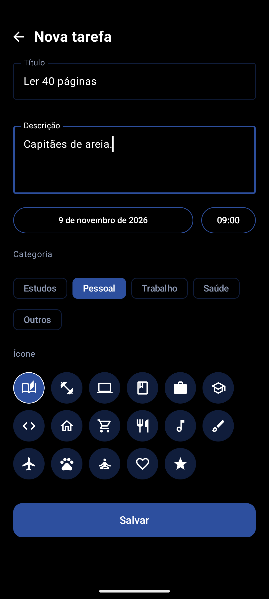
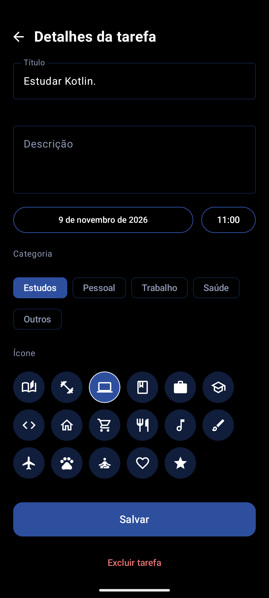
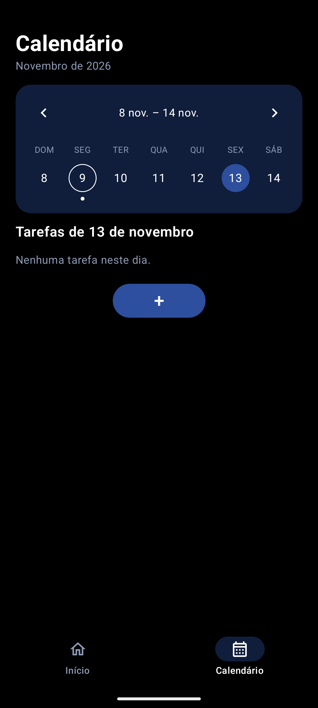

# Lista de Tarefas — Projeto Final (Desenvolvimento Android - iRede)

| | |
|---|---|
| **Aluno** | _Fernando de Freitas Guimarães Medeiros_ |
| **Data de entrega** | _(08/11/26)_ |

## Justificativa da escolha do tema
_organização da rotina é uma necessidade real e o tema cobre bem CRUD, navegação e persistência local.)_

## Descrição do funcionamento
Aplicativo de lista de tarefas com identidade minimalista (fundo preto, detalhes em azul marinho e branco).

**Tela 1 - Criar tarefa:** campos de título e descrição, data, horário, categoria e escolha do ícone. Permite adicionar tarefa à tela inicial.

**Tela 2 – Início:** exibe a data (dia e mês), a frase "O que vamos fazer hoje?", uma barra de progresso (tarefas concluídas / total do dia) e a lista de tarefas de hoje, cada uma com checkbox e o ícone escolhido pelo usuário. O botão "+" abre o cadastro; tocar numa tarefa abre seus detalhes.

**Tela 3 – Detalhes:** Permite salvar, editar nome, horário e ícone e excluir a tarefa.

**Tela 4 – Calendário semanal:** mostra a semana (dom–sáb) com navegação entre semanas, indicador de dias com tarefas e a lista de tarefas do dia selecionado.

## Capturas 

<p>
  
  
  
  

</p>

## Requisitos técnicos atendidos
- Kotlin + Jetpack Compose (3 telas)
- Navigation Compose (`navigation/AppNavigation.kt`)
- Room (entidade `Task`, `TaskDao`, `AppDatabase`)
- MVVM em camadas: `ui` (Compose) → `ViewModel` → `data` (Repository + Room)

## Estrutura
```
app/src/main/java/com/example/listadetarefas/
├── data/        Task, TaskDao, AppDatabase, TaskRepository
├── navigation/  AppNavigation, VmFactory
├── ui/
│   ├── components/  TaskItem, AddButton, TaskIcons
│   ├── home/        HomeScreen, HomeViewModel
│   ├── edit/        EditTaskScreen, EditTaskViewModel
│   ├── calendar/    CalendarScreen, CalendarViewModel
│   └── theme/       Theme
├── MainActivity.kt
└── TaskApp.kt
```

## Badges
- Kotlin
- Compose
- Navigation
- Room
- MVVM

